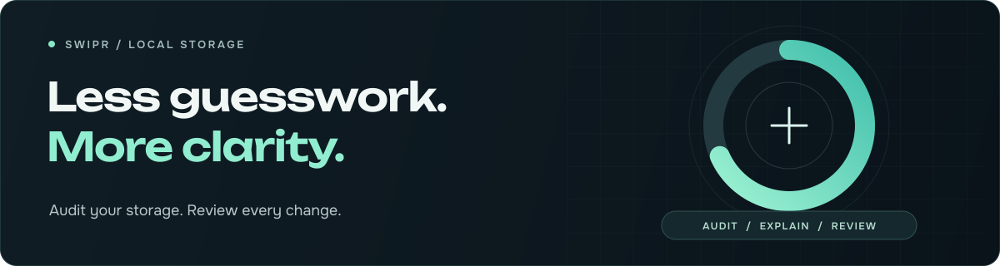

<p align="center">
  
</p>

<p align="center">
  <a href="https://skills.sh/kiron0/swipr/swipr">View Swipr on skills.sh</a>
</p>

# Swipr

**Understand your disk. Review what can go.**

An agent skill for local storage audits and carefully approved cleanup.
Find large files, investigate developer storage, and understand the evidence
before making changes.

## Install

```sh
npx skills add kiron0/swipr --skill swipr
```

Update with `npx skills update swipr`.
skills.sh lists the skill; `kiron0/swipr` identifies its source repository.

**Requirements:** Node.js 22.20+ for installation, Python 3.10+ for helpers,
and an AI agent with local filesystem access.

## Start in your agent

```text
$swipr start
```

Swipr helps you choose a workflow and the folders to inspect.

| Agent | Invocation |
| :--- | :--- |
| Codex | `$swipr start` |
| Claude Code | `/swipr start` |
| Other agents | `Use Swipr: start` |

## Choose a task

These examples use Codex. Replace the folders with your own authorized locations.

| You want to… | Ask Swipr |
| :--- | :--- |
| Quick audit | `$swipr scan quick --root ~/Downloads` |
| Files over 100 MiB | `$swipr find large --root ~/Downloads --min-bytes 104857600` |
| Developer storage | `$swipr scan developer --root ~/Projects/my-app` |
| Storage health | `$swipr scan health --root ~/Projects/my-app` |
| Exact duplicates | `$swipr start --goal duplicates` |
| Commands and options | `$swipr help` |

Duplicate hashing requires separate approval to read file contents.

## Review before changing anything

1. **Audit** your chosen folders within explicit time, depth, and entry limits.
2. **Understand** findings, recorded evidence, side effects, and recovery options.
3. **Review** an exact plan. Supported changes require fresh approval and verification.

Personal files, source, dependencies, credentials, backups, and system state stay
protected from automated cleanup. Most application and system maintenance uses
reviewed native controls. Automated changes are limited to eligible Python bytecode.

> Quarantine keeps files on the same disk and frees no space. Permanent removal
> requires a separate exact plan and explicit irreversible approval.

## Compatibility

| Capability | macOS / Linux | Windows |
| :--- | :--- | :--- |
| Audits and reports | Supported | Supported |
| Duplicate hashing | POSIX handles required | Unavailable |
| Bytecode quarantine / purge | POSIX handles required | Unavailable |
| Native guidance | OS dependent | OS dependent |

<details>
<summary><strong>Terminal usage and detailed documentation</strong></summary>

From a cloned repository:

```sh
python scripts/swipr.py start
python scripts/swipr.py doctor
python scripts/swipr.py scan quick --root "/path/to/folder" --output audit.json
```

For a Skills CLI project installation, the adapter is normally at
`.agents/skills/swipr/scripts/swipr.py`. Use your installation's actual path.

`COMMANDS.md` contains every command, subcommand, option, and approval flow.
`docs/advanced.md` contains recipes for policies, profiles, reports, and history.
`docs/implementation-status.md` records platform limits and supported actions.

</details>

---

MIT License · Copyright (c) 2026 Toufiq Hasan Kiron.
